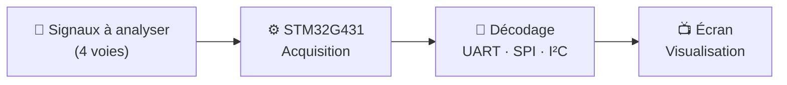

<div align="center">

<!-- 📌 Dépose le logo de l'ESEO dans assets/eseo-logo.png -->


# 🔬 Analyseur Logique

### Voyez ce que vos signaux numériques se disent vraiment.

Un analyseur logique **4 voies** construit autour d'un **STM32G431**,
pour capturer, décoder et visualiser **UART**, **SPI** et **I²C** directement sur un écran.

<br>


</div>

---

## ✨ Le projet

Quand un bus I²C refuse de répondre ou qu'une liaison UART envoie n'importe quoi, un analyseur logique est **l'outil qui permet de voir ce qui se passe réellement sur les fils**.

Ce projet est né d'une envie simple : **concevoir le nôtre**, de zéro, sur une carte STM32, et le rendre **autonome**, c'est-à-dire sans PC obligatoire, avec un affichage intégré des signaux capturés.

C'est un projet d'étudiants, mené à l'**[ESEO](https://www.eseo.fr)** (École Supérieure d'Électronique de l'Ouest), pour apprendre en construisant un vrai outil d'ingénieur.

## 🎯 Fonctionnalités

| | Fonctionnalité | Description |
|---|---|---|
| 📡 | **Acquisition 4 voies** | Capture simultanée de 4 signaux logiques |
| 🧩 | **Décodage de protocoles** | UART, SPI et I²C |
| 📺 | **Visualisation sur écran** | Chronogrammes et trames décodées affichés en direct |
| ⚡ | **Basé sur STM32G431** | Performances et périphériques d'un microcontrôleur moderne |
| 🔓 | **Open source** | Code et documentation ouverts à tous |

## 🧠 Comment ça marche



## 🗺️ Feuille de route

- [x] Lancement du projet et définition du cahier des charges
- [ ] Acquisition fiable des 4 voies
- [ ] Décodage **UART**
- [ ] Décodage **SPI**
- [ ] Décodage **I²C**
- [ ] Affichage des chronogrammes sur écran
- [ ] Interface utilisateur (déclenchement, zoom, choix du protocole)
- [ ] Documentation complète et schémas

## 🚀 Démarrage rapide

> 🚧 Le projet vient de démarrer : cette section sera complétée au fil de l'avancement.

```bash
# Cloner le dépôt
git clone https://github.com/Sensei-Snow/STM32G431_AnalyseurLogique.git
cd STM32G431_AnalyseurLogique
```

## 📁 Structure du dépôt

```text
STM32G431_AnalyseurLogique/
├── app/           # Code de l'application de l'analyseur logique
├── core/          # Code embarqué pour le STM32G431
└── drivers/       # Code des drivers pour les composants électroniques
```

## 👥 Auteurs

| | |
|---|---|
| **Arthur Retaillaud** | Étudiant en E2 à l'ESEO |
| **Timéo Retailleau** | Étudiant en E2 à l'ESEO |

## 🤝 Contribuer

Les idées, remarques et suggestions sont les bienvenues ! N'hésitez pas à ouvrir une **issue** ou une **pull request**.

## 📄 Licence

Ce projet sera distribué sous licence MIT.

---

<div align="center">

Réalisé avec ❤️ à l'<a href="https://www.eseo.fr">ESEO</a>, Angers

⭐ Si le projet vous plaît, laissez une étoile, ça fait toujours plaisir !

</div>
